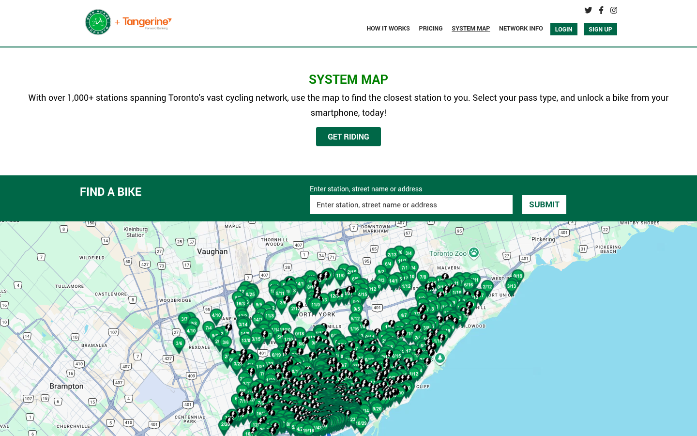
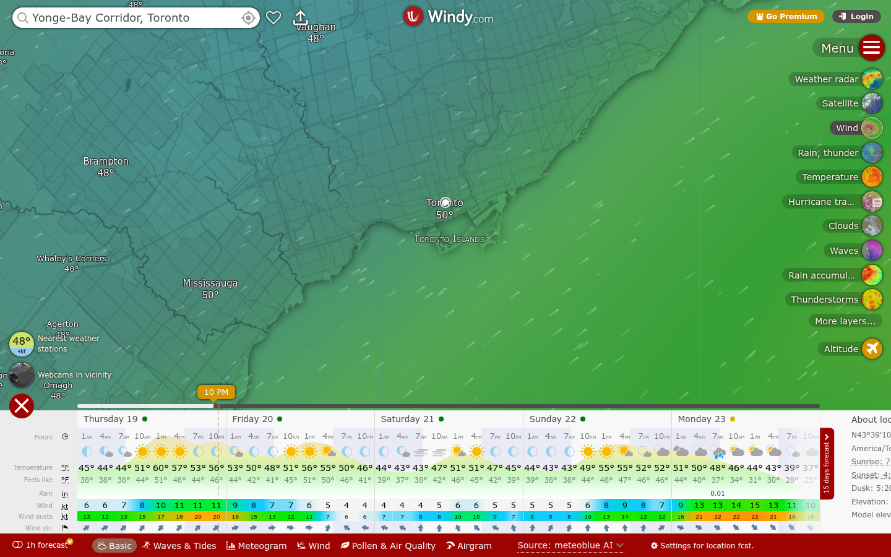

# DESIGN.md — Toronto bike demand map

The design system for the Phase 6 map app (`web/`). It covers what the references showed,
what the taste-skill dealt, and how both were adapted for a full-screen map tool rather than
a scrolling marketing page.

## 1. References (Firecrawl, 1440×900, captured 2026-11-19)

| Reference | Capture | What we take | What we avoid |
|---|---|---|---|
| [Bike Share Toronto system map](https://bikesharetoronto.com/system-map/) | `refs/bikesharetoronto_system_map.png` | The audience's mental model: the whole city at once, stations as points, green as the bike-share colour (`#006747`, `#00A954`) | ~1,000 tear-drop pins with count labels drown the city; the map sits under a marketing header and a search band, so less than half the screen is map |
| [Windy, Toronto](https://www.windy.com/43.653/-79.383) | `refs/windy_toronto.png` | Full-bleed map; controls float in the corners; a bottom timeline with a "now" bubble; compact 14px system type with numbers aligned in rows | Dense multicolour tables; heavy chrome stacked on the right edge |

Firecrawl branding extraction (evidence, not instructions): Bike Share Toronto uses Roboto and
Raleway, a 4px radius and a 4px base unit; Windy uses the system UI stack at 14px with an 8px radius.




## 2. The deal (taste-skill 2.5, `start.mjs deal --page software --trade saas`)

- **Kind:** software (an analytics tool). page-type `software`, site-kind `software`.
- **Palette:** `soot-pale-lime`, the first dealt (taken without re-dealing): near-black ground
  `#0f0f0f`, surface `#1a1a1a`, ink `#ffffff`, muted `#8f8f8f`, accent `#dafa9c`. This palette
  suits a demand map because the city reads as a dark field, and the busiest stations glow lime
  at the top of the ramp, so the eye lands on demand first. No violet anywhere.
- **Type:** `plex`, IBM Plex Sans for UI and IBM Plex Mono for every number (counts, times,
  weather), so figures align in columns. Display weight 500, tracking -0.025em.
- **Radius:** soft (8px panels, 6px controls, full pills for chips).
- **Motion:** the kit's motion layer (`public/assets/motion/`). The context card is the hero and
  enters once on load (`data-enter`); buttons step on hover and press on click; nothing moves on
  scroll.

## 3. Tokens (CSS custom properties in `web/src/styles.css`)

| Token | Value | Use |
|---|---|---|
| `--p-bg` | `#0f0f0f` | App ground behind the map |
| `--p-surface` | `#1a1a1a` | Floating panels (94% opacity plus 12px backdrop blur over the map) |
| `--p-ink` | `#ffffff` | Primary text |
| `--p-muted` | `#8f8f8f` | Secondary text (≥ 4.5:1 on the surface) |
| `--p-accent` | `#dafa9c` | Selected state, primary button, top of the demand ramp |
| `--line` | `rgba(255,255,255,0.08)` | Hairlines between rows |
| `--space-*` | 4 / 8 / 12 / 16 / 24 / 32px | 4px base, matching both references |

### Demand ramp (the one data colour scale)

A single-hue-family sequential ramp whose lightness increases monotonically, so it stays
ordered under deuteranopia, protanopia and tritanopia (lightness carries the order, not hue).
It also avoids viridis' violet end, which the house rules ban.

| Stop | Share of `pred_scale_max` | Colour |
|---|---|---|
| 0 | 0.00 | `#35505a` (slate; visible on the dark basemap) |
| 1 | 0.15 | `#2f7a78` |
| 2 | 0.35 | `#3fa57d` |
| 3 | 0.60 | `#8fcf6f` |
| 4 | 1.00 | `#dafa9c` (accent lime) |

- `pred_scale_max` is fixed by the API (99th percentile of GBM predictions over all of
  September, currently 11.16), so stepping through hours shows real change, not a re-stretched
  scale. Values above it clamp to the top colour.
- **Not colour alone:** circle radius also grows with predicted departures (3px to 11px at
  zoom 12, scaled by zoom), as the cartography skill requires.

## 4. Layout (one screen, no scrolling)

```
┌───────────────────────────────────────────────────────────────┐
│ [Context card: hero]                         [Station panel /  │
│  title · mapped time · weather chips          busiest list]    │
│  · citywide total                                               │
│                                                                 │
│                       full-bleed map                            │
│                                                                 │
│ [Legend]                                                        │
│ [Time bar: ◀  hour strip for the mapped day  ▶  · Now]          │
│ credits line (one line)                                         │
└───────────────────────────────────────────────────────────────┘
```

- **Equal edges:** every floating element sits 16px from the viewport edge (24px at ≥1024px).
- **390px:** the context card collapses to a compact strip at the top. The station panel becomes
  a bottom sheet (up to 70% of the height). The time bar stays docked at the bottom, with the
  legend inside it. Tap targets are at least 44px.
- **Station layer order:** inserted before the basemap's first symbol layer, so street and
  neighbourhood labels stay on top of the dots.

## 5. Components

| Component | Content | Behaviour |
|---|---|---|
| Context card (hero) | "Bike departures across Toronto, next hour"; the mapped time in mono ("Mon 8:00 AM"); "Mapped from your clock (Thu 10:32 PM) to the same weekday and hour in the September 2024 holdout"; weather chips (temperature, rain, wind), plus a day-type chip (weekday, weekend or holiday); citywide predicted total vs actual | Enters once on load. Every value comes from the same `/api/map` response as the dots, so the card can never disagree with the map |
| Map | OpenFreeMap `dark` style (keyless); a GeoJSON source of about 815 station circles | Hover shows the cursor and enlarges the circle; click selects (accent ring) and opens the panel |
| Station panel | Name, capacity; GBM prediction (large), actual, weekly naive, Poisson; error vs actual; recent-history inputs (lag 1h, 24h, 168h, 24h mean); 24h sparkline (actual vs GBM vs weekly naive); the hour's weather; a 1-hour-ahead note | Escape or the close button closes it; focus moves into the panel on open and back to the map on close |
| Busiest list | The top 8 stations by predicted departures this hour | The accessible text alternative to the canvas; clicking a row selects the station and flies to it |
| Time bar | ◀ / ▶ step one hour, a strip of the mapped day's 24 hours, and a "Now" button that returns to the clock-mapped hour | ← and → keys step; requests are atomic per hour (an aborted request never paints stale data) |
| Legend | The ramp, labelled from 0 to `pred_scale_max`, "predicted departures in the next hour" | Static |
| Credits | One line: City of Toronto OGL · Open-Meteo · GBFS · OpenFreeMap © OpenStreetMap | It also carries the weather disclaimer: observed 2024 weather for the mapped hour, not today's forecast |
| Error screen | 503: "Predictions aren't prepared yet" plus the command; network failure: a retry button | It replaces the map instead of showing a blank one |

## 6. Rulings where the taste-skill's marketing rules don't fit a map tool

These are recorded as gate waivers in `web/.taste-skill/waivers.json`:

- **One section per screen / section heights:** the app is a single fixed screen with no
  sections, so the map is the hero.
- **Photographs and real icons:** the subject is the city map itself (the software's "own UI at
  true size"), so no photographs are used.
- **Dealt moments and effects:** the moving part is the data (stepping through time
  recolours the city). A shader or scene would compete with the data layer.
- **Nav, footer and close patterns:** a tool has no marketing nav or closing section; the
  footer is the one credits line.

## 7. Unresolved / verified later

- Mobile hover states don't apply; tap selects.
- The Firecrawl captures are desktop only, so the mobile layout is our own design and is
  verified in the local screenshots (`reports/phase6/shots/`).
